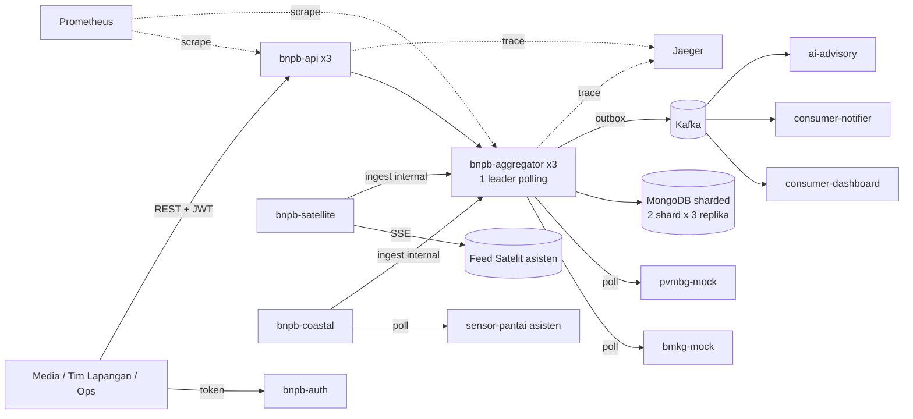

# IF4031 - AturATur · Platform Koordinasi Bencana BNPB (Milestone 2)

BNPB menarik data BMKG (gempa/tsunami) dan PVMBG (gunung api), menerima aliran Feed Satelit
(kebakaran) dan Sensor Pantai (pesisir), memetakannya menjadi `HazardEvent`, menyimpannya di
Canonical Store yang di-shard, lalu menyajikannya ke client dan menyebarkannya lewat Kafka.
Seluruh komponen berjalan di Kubernetes (k3s).



## Menjalankan sistem

### Prasyarat
- `kubectl` ≥ 1.30, `git`, `bash`, `curl`, `python3`
- Pengembangan lokal: Docker + [`k3d`](https://k3d.io). Demo: cluster k3s multi-node (lihat
  [docs/DEMO-CLUSTER.md](docs/DEMO-CLUSTER.md), mulai dari pembuatan VM).
- `.env`: `cp .env.example .env`, lalu ganti semua nilai `change-me`. Token dari asisten:
  `AUDIT_TOKEN`, `SATELLITE_TOKEN`, `PANTAI_AUTH_TOKEN`.

### Satu perintah deploy
```bash
# Lokal (k3d, 1 server + 2 agent): buat cluster, build & import image, lalu deploy
scripts/k3d-up.sh && scripts/deploy.sh

# Cluster demo (k3s multi-node, image dari GHCR)
OVERLAY=demo scripts/deploy.sh
```
`deploy.sh` membuat Secret `bnpb-secrets` dari kunci rahasia di `.env`, menerapkan
`k8s/overlays/<OVERLAY>`, lalu menunggu semua workload siap. Semua komponen berada di namespace
`sistem-informasi-kebencanaan-bnpb`.

### Setelah mengubah kode
- **Lokal (k3d)**: `SKIP_CLUSTER=1 scripts/k3d-up.sh` (build ulang + restart pod).
- **Cluster demo**: node menarik image dari GHCR, jadi setiap perubahan kode harus di-push dulu:
  ```bash
  git commit ...                                   # script menolak jalan bila services/ belum di-commit
  docker login ghcr.io -u angkaberapa              # sekali; token classic ber-scope write:packages
  scripts/push-images.sh                           # build + push ghcr.io/angkaberapa/aat-*:<commit>,
                                                   # lalu menulis tag itu di k8s/overlays/demo
  git commit -am "chore(k8s): demo images <commit>" && git push
  OVERLAY=demo scripts/deploy.sh                   # di cluster demo, setelah git pull
  ```
  Push hanya bisa dari akun yang punya akses tulis ke package `angkaberapa/aat-*`. Package sudah
  public; service baru menghasilkan package baru yang perlu dijadikan public sekali.

### Endpoint
Lokal memakai `localhost`; cluster demo memakai IP node mana pun (ServiceLB k3s).

| Port | Service | Port | Service |
|---:|---|---:|---|
| 8080 | bnpb-api | 8091 | dashboard consumer + analitik (`/analytics`) |
| 8090 | bnpb-auth | 8092 | notifier (`/notifications`) |
| 8081 / 8082 | bmkg-mock / pvmbg-mock | 8094 | ai-advisory (`/advisories`, `/summary`) |
| 3000 | Grafana (dashboard metrik) | 9090 | Prometheus |
| 16686 | Jaeger (trace) | | |

Service internal (aggregator, satellite, coastal, Mongo, Kafka) tidak dibuka; akses dengan
`kubectl -n sistem-informasi-kebencanaan-bnpb port-forward svc/bnpb-aggregator 8000:8000`.

Variabel yang dipakai contoh di bawah:
```bash
set -a; . ./.env; set +a
API=http://localhost:8080; AUTH=http://localhost:8090; AGG=http://localhost:8000   # AGG via port-forward
token() { curl -s -X POST $AUTH/token -H 'Content-Type: application/json' \
  -d "{\"client_id\":\"$1\",\"client_secret\":\"$2\"}" | python3 -c 'import sys,json;print(json.load(sys.stdin)["access_token"])'; }
OPS=$(token $CLIENT_OPS_ID $CLIENT_OPS_SECRET); FIELD=$(token $CLIENT_FIELD_ID $CLIENT_FIELD_SECRET)
```

## Deklarasi topologi

| Node | Jenis | Host fisik | Peran | Label |
|---|---|---|---|---|
| node-a1 | VM (VirtualBox) | Laptop A — _CPU/RAM_ | control-plane + worker | host-a, shard-0 |
| node-a2 | VM | Laptop A | worker | host-a, shard-1 |
| node-b1 | VM | Laptop B — _CPU/RAM_ | worker | host-b, shard-0 |
| node-b2 | VM | Laptop B | worker | host-b, shard-1 |
| node-c1 | VM | Laptop C — _CPU/RAM_ | worker | host-c, shard-0 |
| node-c2 | VM | Laptop C | worker | host-c, shard-1 |

_TODO: isi CPU/RAM tiap laptop dan IP node._ Skenario yang mematikan node hanya dikenakan pada
worker non-control-plane. Komponen berstate satu replika (Kafka, consumer, satellite, coastal,
sensor-pantai) di-pin ke control-plane karena PVC `local-path` terikat ke satu node.

## Variabel konfigurasi

- **Rahasia** (`.env` → Secret `bnpb-secrets`, daftar lengkap di `SECRET_KEYS` pada
  `scripts/deploy.sh`): `BMKG_API_KEY`, `PVMBG_TOKEN`, `AUDIT_TOKEN`, `MONGO_ROOT_USER`,
  `MONGO_ROOT_PASSWORD`, `MONGO_CLUSTER_KEY`, `JWT_SIGNING_KEY`, `CLIENT_{MEDIA,FIELD,OPS}_{ID,SECRET}`,
  `PANTAI_AUTH_TOKEN`, `SATELLITE_TOKEN`, `COASTAL_INGEST_TOKEN`, `FIELD_REPORT_INGEST_TOKEN`,
  `GRAFANA_ADMIN_PASSWORD`.
- **Non-rahasia** (ConfigMap per service di `k8s/base/config.yaml`, `satellite.yaml`,
  `coastal.yaml`, `observability.yaml`). Setiap kunci beserta artinya dijelaskan di
  `.env.example`. Yang paling sering diubah saat pengujian:

| Variabel | Bawaan | Arti |
|---|---|---|
| `POLL_INTERVAL_SECONDS` / `SOURCE_STALE_AFTER_SECONDS` | 3 / 15 | Siklus poll BMKG/PVMBG dan batas data dianggap stale |
| `LEASE_DURATION_SECONDS` / `LEASE_RENEW_DEADLINE_SECONDS` | 15 / 10 | Kapan leader aggregator dianggap hilang (P2) |
| `MAX_CONCURRENT_REQUESTS` / `MEDIA_MAX_CONCURRENT_REQUESTS` / `RATE_LIMIT_RPS` | 128 / 96 / 300 | Batas beban bnpb-api, prioritas Tim Lapangan (P5) |
| `PVMBG_COMPATIBILITY_VERSION` | 2 | Versi skema PVMBG yang diterima otomatis (P3) |
| `SATELLITE_ALLOWED_LATENESS_SECONDS` | 21600 | Batas keterlambatan deteksi (P4) |
| `OTEL_TRACES_SAMPLER` | `parentbased_always_on` | Sampling trace (turunkan saat load test besar) |

## Observabilitas
- **Metrik**: Grafana `:3000` → dashboard "BNPB - Observabilitas" (throughput, error rate, latensi
  per service, panggilan keluar, leader P2, Feed Satelit, Sensor Pantai, consumer Kafka, SLO).
- **Trace**: Jaeger `:16686` → service `bnpb-api` / `bnpb-coastal` → Find Traces. Satu trace
  menyambung API → aggregator → Mongo → Kafka → consumer, dengan durasi tiap langkah.
- **Log**: JSON ber-`correlation_id` dan `trace_id`:
  `kubectl -n sistem-informasi-kebencanaan-bnpb logs deploy/bnpb-aggregator | grep <id>`.

## Tester Agent
```bash
kubectl apply -f https://raw.githubusercontent.com/susTuna/if4031-tester-agent/ebb55261711123a9a211739ffbf140a275caa6da/manifest.yaml
kubectl exec -n tester-agent daemonset/tester-agent -- /app list
kubectl exec -n tester-agent daemonset/tester-agent -- /app run practice <nama>
kubectl logs -n tester-agent daemonset/tester-agent -f
```

## Memicu skenario pengujian

### P1 — Sharding & replikasi (overlay demo)
1. **Muat katalog gempa**: `curl -X POST $AGG/internal/catalog/seismic-events -H "Authorization: Bearer $AUDIT_TOKEN" -H 'Content-Type: application/json' -d @katalog.json` (body `{"events":[...]}`).
2. **Sebaran & beban per node**: `pwsh scripts/p1-inspect.ps1`, `pwsh scripts/p1-measure-load.ps1 -DurationSeconds 120`.
3. **Baca lintas shard**: `curl "$API/hazards?limit=50" -H "Authorization: Bearer $OPS"`, halaman berikutnya dengan `cursor` dari `meta`.
4. **Node mati**: matikan VM worker (atau skenario Tester Agent), lalu bandingkan `curl "$AGG/internal/audit/checksum?source=BMKG" -H "Authorization: Bearer $AUDIT_TOKEN"` dengan checksum asisten; respons selama pemulihan memuat `partial`/`unavailable_units`.
5. **Node baru**: `pwsh scripts/p1-replace-member.ps1 -StatefulSet mongo-shard-0 -ReplacementNode <node> -ConfirmDataLoss`.
6. **Dashboard analitik**: `http://<node>:8091/analytics`.

### P2 — Aggregator ≥3 instance, satu leader
1. **Leader & failover**: `kubectl -n sistem-informasi-kebencanaan-bnpb get lease bnpb-aggregator-ingest`, hapus pod pemegang lease, lalu amati leader baru (< 60 s) di Grafana (panel "Leader per pod").
2. **Tepat sekali**: `kubectl -n sistem-informasi-kebencanaan-bnpb logs deploy/bmkg-mock | grep -o '"caller_instance":"[^"]*"' | uniq -c` hanya memuat pod leader (berganti hanya saat failover); Grafana panel "Tulisan ditolak fencing".
3. **Freeze** (di VM worker tempat leader berjalan): `sudo kill -STOP <pid>` selama > 15 s, lalu `sudo kill -CONT <pid>`; log memuat `write rejected by fencing token, stepping down`.
4. **Clock skew** (di VM worker): `sudo timedatectl set-ntp false && sudo date -s '+45 seconds'`, lalu `-75 seconds`; tidak ada dua epoch yang sama-sama berhasil menulis.
5. **Load test 10.000 VU + scale 3→5→2 / ganti versi**: `loadtest/p2m2-scale.sh` dan `MODE=rollout loadtest/p2m2-scale.sh` (cluster demo: `K6_NETWORK=host API_HOST=<ip-node>`). Hasil di `loadtest/results/`.

### P3 — Skema berubah, pesan rusak, laporan lapangan
1. **Perubahan skema**: `curl -X POST localhost:8082/admin/schema-version -H 'Content-Type: application/json' -d '{"version":3}'` (2 = field baru, diterima otomatis; 3 = rename `alert_level`; 4 = tipe berubah; 5 = field wajib hilang).
2. **Pesan rusak**: `curl -X POST localhost:8082/admin/payload-mode -d '{"mode":"truncated"}' -H 'Content-Type: application/json'` (`deep`, `invalid_utf8`, `oversized`, `normal`).
3. **Periksa pesan gagal**: `curl "$AGG/internal/audit/unprocessed" -H "Authorization: Bearer $AUDIT_TOKEN"` (`retrying` vs `parked`).
4. **Proses ulang**: ubah `PVMBG_COMPATIBILITY_VERSION` di `k8s/base/config.yaml`, `scripts/deploy.sh`, lalu proses seluruh antrean dengan `curl -X POST "$AGG/internal/admin/unprocessed/replay?limit=100" -H "Authorization: Bearer $AUDIT_TOKEN"`, atau satu pesan tanpa terhalang poison message lain dengan `curl -X POST "$AGG/internal/admin/unprocessed/replay?message_id=<message-id>" -H "Authorization: Bearer $AUDIT_TOKEN"`.
5. **Laporan lapangan**: `curl -X POST $API/field-reports -H "Authorization: Bearer $FIELD" -H 'Idempotency-Key: r-001' -H 'Content-Type: application/json' -d '{"occurred_at":"2026-11-20T10:00:00Z","area_name":"Palu","latitude":-0.9,"longitude":119.87,"severity":"SIAGA","description":"banjir"}'` → `202`; matikan pod aggregator setelahnya, laporan tetap diproses tepat sekali.

### P4 — Feed Satelit (butuh `SATELLITE_TOKEN`)
- Status & lag: Grafana baris "P4 - Feed Satelit", `GET $API/hazards?hazard_type=WILDFIRE` (`meta.sources.SATELIT`).
- Putus-sambung / komponen mati: `kubectl delete pod -l app=bnpb-satellite`; berlanjut dari offset tersimpan.
- Sesi ujian: `curl -X POST https://satellite.naufarrel.dev/v1/exam/start -H "Authorization: Bearer <token-ujian>"`.

### P5 — Sensor Pantai
- Profil sensor: `PANTAI_PROFILE` di `k8s/base/coastal.yaml` (`practice` / `exam`).
- Prioritas beban: `K6_NETWORK=k3d-bnpb loadtest/run.sh p5-priority.js -e API_URL=http://k3d-bnpb-server-0:8080 -e AUTH_URL=http://k3d-bnpb-server-0:8090` (demo: `K6_NETWORK=host`, IP node). Media mendapat 429, Tim Lapangan tetap 200.
- Peringatan kritis & SLO: `curl localhost:8092/notifications`, Grafana baris "SLO jalur peringatan".
- Kesehatan sensor: `meta.sources.SENSOR_PANTAI` dan panel "Circuit breaker".

### Bonus AI-native — advisory anomali
- Service `bnpb-ai-advisory` membaca topic `hazard-events` dengan consumer group sendiri
  (`ai-advisory`) dan membuka `GET /advisories` serta `GET /summary`.
- Model: Gaussian online per `(source, hazard_type, area)`. Yang dipelajari adalah laju event dan
  severity; skor di atas `AI_ANOMALY_THRESHOLD` menghasilkan advisory.
- `GET /summary` memanggil LLM OpenAI-compatible kalau `LLM_BASE_URL`, `LLM_MODEL`, dan
  `LLM_API_KEY` diisi. Timeout `LLM_TIMEOUT_MS` (default 3000). Kalau LLM mati, lambat, atau belum
  dikonfigurasi, endpoint tetap 200 dengan `source: "fallback"` dan ringkasan template.
- Contoh DeepSeek: `LLM_BASE_URL=https://api.deepseek.com`, `LLM_MODEL=deepseek-flash`,
  `LLM_THINKING=disabled` (thinking dimatikan supaya ringkasan tetap cepat).
- Isolasi: service ini tidak menulis ke Canonical Store, tidak memanggil producer, dan tidak
  mengubah `HazardEvent`. Matikan pod-nya dan ingest/alert tetap berjalan.
- Demo cepat:
  ```bash
  docker compose up -d --build bnpb-ai-advisory
  curl -s localhost:8094/advisories | python3 -m json.tool
  # kirim burst event ke Kafka, lalu lihat advisory baru
  bash scripts/ai-advisory-demo.sh
  ```
- Metrik: `ai_advisory_events_total`, `ai_advisory_generated_total`, `ai_advisory_score`.

### Pengujian fungsi M1 (masih berlaku)
Keputusan M1 terbawa ke M2. Langkah uji M1 (setup Postman, scope Media vs Tim Lapangan, refresh
token, outage PVMBG + `stale_since`, consumer menyusul) ada di [docs/README-M1.md](docs/README-M1.md);
jalankan request yang sama ke endpoint cluster (tabel Endpoint di atas), bukan ke docker compose.

## Struktur repo
`services/` (satu folder per service), `k8s/base` + `k8s/overlays/{dev,demo}`, `scripts/`
(deploy, build image, P1), `loadtest/` (k6), `docs/DEMO-CLUSTER.md` (panduan VM & cluster).
Kode yang dibuat dengan bantuan LLM ditandai di komentar kode.
