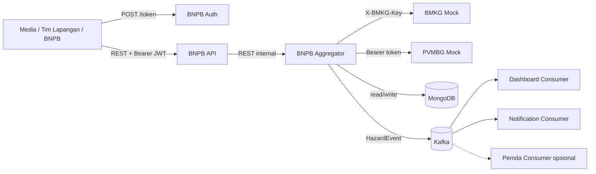

# IF4031 - AturATur

## Arsitektur sistem secara umum



| Service | Implementasi | Port host | Peran |
|---|---|---:|---|
| `bmkg-mock` | TypeScript + Fastify | `8081` | Sumber SeismicEvent dan TsunamiWarning |
| `pvmbg-mock` | Python + FastAPI | `8082` | Sumber VolcanicReport, schema switch, dan controlled outage |
| `bnpb-aggregator` | Go | internal `8000` | Polling, canonical mapping, MongoDB owner, dan Kafka producer |
| `bnpb-api` | Go | `8080` | API yang digunakan client downstream |
| `bnpb-auth` | Go | `8090` | Penerbit JWT dan refresh token |
| `bnpb-consumer-dashboard` | Go | `8091` | Materialized dashboard dari Kafka |
| `bnpb-consumer-notifier` | Go | `8092` | Simulasi notifikasi SIAGA/AWAS |
| `bnpb-consumer-pemda` | Go | `8093` | Consumer tambahan melalui profile `pemda` |
| `mongo` | MongoDB 7 | tidak dipublikasi | Canonical Store milik Aggregator |
| `kafka` | Kafka 3.9 KRaft | tidak dipublikasi | Distribusi perubahan HazardEvent |

## Cara menjalankan sistem

### Requirement

- Git
- Docker Desktop atau Docker Engine dengan Docker Compose v2
- Postman Desktop atau Postman Web dengan Desktop Agent
- PowerShell Windows
- Git Bash atau WSL (untuk menjalankan skrip load test P2)

### 1. Siapkan konfigurasi

Jalankan dari root repository:

```powershell
Copy-Item .env.example .env
notepad .env
```

### 2. Jalankan semua service

```powershell
docker compose config --quiet
docker compose up -d --build
docker compose ps
```

Tunggu sampai seluruh service pada kolom `STATUS` bertuliskan `healthy`

### 3. Periksa endpoint melalui Postman

Buat collection bernama **AAT M1**, lalu tambahkan request `GET` berikut. Masing-masing harus menghasilkan status `200` dan body dengan `status: "ok"`:

| Service | URL |
|---|---|
| BNPB API | `http://localhost:8080/health` |
| BMKG Mock | `http://localhost:8081/health` |
| PVMBG Mock | `http://localhost:8082/health` |
| BNPB Auth | `http://localhost:8090/health` |
| Dashboard Consumer | `http://localhost:8091/health` |
| Notification Consumer | `http://localhost:8092/health` |

Dokumentasi interaktif PVMBG juga tersedia di <http://localhost:8082/docs>

### 4. Siapkan Postman Environment

Buat environment bernama **AAT Local** dengan nilai berikut. Nilai kredensial harus disesuaikan apabila `.env` sudah diubah

| Variable | Initial value |
|---|---|
| `api_url` | `http://localhost:8080` |
| `auth_url` | `http://localhost:8090` |
| `bmkg_url` | `http://localhost:8081` |
| `pvmbg_url` | `http://localhost:8082` |
| `dashboard_url` | `http://localhost:8091` |
| `notifier_url` | `http://localhost:8092` |
| `pemda_url` | `http://localhost:8093` |
| `bmkg_key` | `bmkg-key-change-me` |
| `pvmbg_token` | `pvmbg.v1.change-me` |
| `media_id` | `media` |
| `media_secret` | `media-secret-change-me` |
| `field_id` | `field-team` |
| `field_secret` | `field-secret-change-me` |
| `ops_id` | `bnpb-ops` |
| `ops_secret` | `ops-secret-change-me` |
| `media_token` | kosong |
| `field_token` | kosong |
| `field_refresh_token` | kosong |
| `ops_token` | kosong |

Aktifkan environment **AAT Local** sebelum mengirim request

### 5. Ambil token melalui Postman

Buat tiga request `POST {{auth_url}}/token`. Pilih **Body > raw > JSON**

Body untuk Media:

```json
{
  "client_id": "{{media_id}}",
  "client_secret": "{{media_secret}}"
}
```

Body untuk Tim Lapangan:

```json
{
  "client_id": "{{field_id}}",
  "client_secret": "{{field_secret}}"
}
```

Body untuk BNPB Operations:

```json
{
  "client_id": "{{ops_id}}",
  "client_secret": "{{ops_secret}}"
}
```

Ketiganya harus menghasilkan `200`. Salin `access_token` masing-masing ke `media_token`, `field_token`, dan `ops_token`. Salin juga refresh token Tim Lapangan ke `field_refresh_token`. Token dapat disimpan otomatis menggunakan script Post-response berikut, dengan mengganti nama variabel sesuai request:

```javascript
const body = pm.response.json();
pm.environment.set("field_token", body.access_token);
pm.environment.set("field_refresh_token", body.refresh_token);
```

Untuk memeriksa data awal, buat request `GET {{api_url}}/hazards?limit=5`, pilih **Authorization > Bearer Token**, lalu isi `{{ops_token}}`.

### Menghentikan dan mereset sistem

Menghentikan container tanpa menghapus data:

```powershell
docker compose down
```

Mereset seluruh data MongoDB, Kafka, dan state consumer:

```powershell
docker compose down -v
```

## Variabel konfigurasi

Semua nilai yang dapat diatur pengguna terdapat di `.env.example`. Compose hanya memberikan
variabel yang diperlukan kepada masing-masing container, misalnya kredensial BMKG dan PVMBG
tidak diberikan kepada `bnpb-api`

### Port

| Variabel | Default contoh | Digunakan oleh | Keterangan |
|---|---:|---|---|
| `LOG_LEVEL` | `INFO` | seluruh service | Level structured logging |
| `API_PORT` | `8080` | Compose | Port host BNPB API |
| `BMKG_PORT` | `8081` | Compose | Port host BMKG mock |
| `PVMBG_PORT` | `8082` | Compose | Port host PVMBG mock |
| `AUTH_PORT` | `8090` | Compose | Port host Auth Service |
| `DASHBOARD_PORT` | `8091` | Compose | Port host Dashboard Consumer |
| `NOTIFIER_PORT` | `8092` | Compose | Port host Notification Consumer |
| `PEMDA_PORT` | `8093` | Compose | Port host consumer opsional Pemda |

### Sumber dan Aggregator

| Variabel | Default contoh | Keterangan |
|---|---:|---|
| `BMKG_API_KEY` | `bmkg-key-change-me` | Nilai header `X-BMKG-Key`, wajib diisi |
| `BMKG_RESPONSE_DELAY_MS` | `100` | Delay respons BMKG dalam milidetik |
| `BMKG_NEW_EVENT_INTERVAL_SECONDS` | `10` | Interval pembuatan data BMKG |
| `PVMBG_TOKEN` | `pvmbg.v1.change-me` | Bearer token PVMBG, wajib diisi |
| `PVMBG_RESPONSE_DELAY_MIN_MS` | `500` | Batas bawah delay acak PVMBG |
| `PVMBG_RESPONSE_DELAY_MAX_MS` | `3000` | Batas atas delay acak PVMBG |
| `PVMBG_NEW_EVENT_INTERVAL_SECONDS` | `10` | Interval pembuatan laporan PVMBG |
| `POLL_INTERVAL_SECONDS` | `3` | Interval polling Aggregator |
| `UPSTREAM_TIMEOUT_MS` | `5000` | Timeout Aggregator ke sumber, harus melebihi delay normal maksimum PVMBG |
| `SOURCE_STALE_AFTER_SECONDS` | `15` | Batas tanpa poll sukses sebelum data ditandai stale |
| `SNAPSHOT_DEFAULT_LIMIT` | `200` | Jumlah maksimum default untuk snapshot `/hazards` |
| `SNAPSHOT_MAX_LIMIT` | `1000` | Nilai `limit` terbesar yang diterima |

### API dan autentikasi

| Variabel | Default contoh | Keterangan |
|---|---:|---|
| `API_UPSTREAM_TIMEOUT_MS` | `2000` | Timeout BNPB API ke Aggregator |
| `MAX_CONCURRENT_REQUESTS` | `128` | Batas request aktif bersamaan, `0` menonaktifkan |
| `RATE_LIMIT_RPS` | `300` | Token bucket per identitas JWT, `0` menonaktifkan |
| `RATE_LIMIT_BURST` | `600` | Kapasitas burst per identitas JWT |
| `JWT_SIGNING_KEY` | `change-me-to-a-long-random-string` | Seed private signing key Ed25519, minimal 32 karakter |
| `JWT_ISSUER` | `bnpb-auth` | Claim issuer yang diterbitkan dan diverifikasi |
| `JWT_AUDIENCE` | `bnpb-api` | Claim audience yang diterbitkan dan diverifikasi |
| `ACCESS_TOKEN_TTL_SECONDS` | `60` | Umur access token |
| `REFRESH_TOKEN_TTL_SECONDS` | `3600` | Umur refresh token, harus lebih panjang dari access token |
| `JWKS_CACHE_TTL_SECONDS` | `300` | Lama public signing key disimpan BNPB API |
| `CLIENT_MEDIA_ID` | `media` | Identitas client Media |
| `CLIENT_MEDIA_SECRET` | `media-secret-change-me` | Secret client Media, wajib unik |
| `CLIENT_FIELD_ID` | `field-team` | Identitas client Tim Lapangan |
| `CLIENT_FIELD_SECRET` | `field-secret-change-me` | Secret Tim Lapangan, wajib unik |
| `CLIENT_OPS_ID` | `bnpb-ops` | Identitas client BNPB Operations |
| `CLIENT_OPS_SECRET` | `ops-secret-change-me` | Secret BNPB Operations, wajib unik |

### Penyimpanan, broker, dan consumer

| Variabel | Default contoh | Keterangan |
|---|---:|---|
| `MONGO_ROOT_USER` | `bnpb` | Username MongoDB, wajib diisi |
| `MONGO_ROOT_PASSWORD` | `change-me` | Password MongoDB, wajib diisi |
| `MONGO_DB` | `bnpb` | Nama database Canonical Store |
| `KAFKA_HAZARD_TOPIC` | `hazard-events` | Topic perubahan HazardEvent |
| `KAFKA_TOPIC_PARTITIONS` | `3` | Jumlah partition topic |
| `KAFKA_TOPIC_RETENTION_HOURS` | `168` | Retensi topic dalam jam |
| `OUTBOX_RELAY_INTERVAL_MS` | `1000` | Interval relay transactional outbox |
| `OUTBOX_BATCH_SIZE` | `100` | Maksimum event per batch relay |
| `DASHBOARD_PROCESSING_DELAY_MS` | `0` | Delay buatan per event pada Dashboard Consumer |
| `NOTIFIER_PROCESSING_DELAY_MS` | `0` | Delay buatan per event pada Notification Consumer |

## Skenario pengujian P1-P5

Pengujian fungsional di bawah menggunakan collection dan environment Postman yang telah dibuat pada langkah sebelumnya. Terminal hanya digunakan untuk mengatur lifecycle container, menjalankan load test, dan menjalankan automated test

### P1

1. Buat `GET {{pvmbg_url}}/volcanic-reports`. Pilih **Authorization > Bearer Token** dan isi `{{pvmbg_token}}`. Kirim request dan pastikan schema versi 1 belum memiliki `confidence_level`
2. Buat `POST {{pvmbg_url}}/admin/schema-version`, pilih **Body > raw > JSON**, lalu kirim:

```json
{"version": 2}
```

3. Kirim kembali request laporan PVMBG. Setiap laporan sekarang memiliki
   `confidence_level` tanpa ada restart container
4. Tunggu beberapa detik agar laporan baru dipoll. Buat `GET {{api_url}}/hazards?source=PVMBG&limit=20` menggunakan Bearer Token `{{ops_token}}`. Data kanonis menyimpan nilai tersebut pada `attributes.confidence_level`
5. Kembalikan schema ke versi 1 menggunakan request admin yang sama dengan body:

```json
{"version": 1}
```

### P2

Untuk kriteria head-of-line blocking, ubah sementara kedua nilai berikut di `.env` menjadi `3000`, lalu recreate PVMBG:

```text
PVMBG_RESPONSE_DELAY_MIN_MS=3000
PVMBG_RESPONSE_DELAY_MAX_MS=3000
```

```powershell
docker compose up -d --force-recreate pvmbg-mock
```

Jalankan dari Git Bash atau WSL:

```bash
bash ./loadtest/run.sh p2-k1-hol.js
bash ./loadtest/run.sh p2-k2-load.js
bash ./loadtest/run.sh p2-k3-outage.js
```

- `p2-k1-hol.js` membuktikan query BMKG tidak tertahan oleh PVMBG yang lambat
- `p2-k2-load.js` menjalankan 60 virtual users selama 75 detik dan mencatat throughput,
  persentil latensi, 429, dan error rate
- `p2-k3-outage.js` menyalakan outage PVMBG, memeriksa data stale tetap tersedia, lalu
  memulihkannya tanpa restart

Hasil Markdown dan JSON ditulis ke `loadtest/results/`. Setelah pengujian, kembalikan delay PVMBG di `.env` ke `500` dan `3000`, lalu jalankan kembali perintah recreate di atas

Outage juga dapat didemonstrasikan melalui Postman:

1. Buat `POST {{pvmbg_url}}/admin/outage` dengan body JSON `{"enabled":true,"mode":"error"}`
2. Tunggu beberapa detik
3. Kirim `GET {{api_url}}/hazards?hazard_type=VOLCANIC` dengan Bearer Token `{{ops_token}}`
4. Pastikan respons tetap `200`, data lama tetap tersedia, dan `meta.stale` bernilai `true`
5. Periksa `GET {{api_url}}/hazards?hazard_type=SEISMIC`; data BMKG harus tetap fresh
6. Pulihkan PVMBG melalui request admin yang sama dengan body `{"enabled":false}`
7. Tunggu satu siklus polling dan pastikan `meta.stale` kembali `false` tanpa restart

### P3

Gunakan Postman untuk menjalankan tabel berikut:

| Skenario | Request | Authorization | Hasil yang diharapkan |
|---|---|---|---|
| Media membaca ringkasan | `GET {{api_url}}/hazards?limit=1` | Bearer `{{media_token}}` | `200`; tidak ada `source_ref_id`, `latitude`, `longitude`, atau `attributes` |
| Media meminta raw field | `GET {{api_url}}/hazards?fields=hazard_id,latitude,attributes` | Bearer `{{media_token}}` | `403 insufficient_scope` |
| Tim Lapangan meminta raw field | URL yang sama | Bearer `{{field_token}}` | `200`; raw field tersedia |
| Tanpa token | `GET {{api_url}}/hazards` | No Auth | `401` |
| Token invalid | `GET {{api_url}}/hazards` | Bearer `invalid-token` | `401` |

Untuk menguji expiry, terbitkan token baru, tunggu lebih dari 60 detik, lalu kirim kembali
request dengan token tersebut

Untuk menguji refresh-token rotation, buat `POST {{auth_url}}/token/refresh` dengan body:

```json
{
  "refresh_token": "{{field_refresh_token}}"
}
```

### P4

MongoDB tidak membuka port ke host:

```powershell
Test-NetConnection localhost -Port 27017
```

`TcpTestSucceeded` seharusnya `False`, sedangkan data tetap dapat dibaca melalui BNPB API. Untuk membuktikan persistensi, ambil data, restart hanya Aggregator, lalu baca kembali:

1. Di Postman, kirim `GET {{api_url}}/hazards?limit=1` dengan Bearer Token `{{ops_token}}`. Simpan respons atau catat `hazard_id`.
2. Restart hanya Aggregator:

```powershell
docker compose restart bnpb-aggregator
Start-Sleep -Seconds 8
```

3. Kirim kembali request Postman yang sama. Data dan `hazard_id` sebelumnya seharusnya tetap tersedia karena volume MongoDB tidak ikut direstart

### P5

Periksa kedua consumer utama melalui Postman:

| Request | Hasil yang diharapkan |
|---|---|
| `GET {{dashboard_url}}/dashboard` | `200`, statistik dan HazardEvent terbaru |
| `GET {{notifier_url}}/notifications` | `200`, statistik dan notifikasi SIAGA/AWAS |

Tambahkan consumer Pemda tanpa mengubah atau me-restart producer:

```powershell
docker compose --profile pemda up -d bnpb-consumer-pemda
```

Kirim `GET {{pemda_url}}/dashboard` melalui Postman

Untuk menunjukkan consumer dapat menyusul event yang terlewat:

```powershell
docker compose stop bnpb-consumer-dashboard
Start-Sleep -Seconds 20
docker compose start bnpb-consumer-dashboard
Start-Sleep -Seconds 8
```

Kirim kembali `GET {{dashboard_url}}/dashboard` melalui Postman. Nilai `stats.processed` seharusnya bertambah dan event yang dibuat selama consumer mati harus dapat disusul.

Untuk menunjukkan transactional outbox menahan event ketika broker berhenti:

```powershell
docker compose stop kafka
Start-Sleep -Seconds 15
docker compose start kafka
Start-Sleep -Seconds 15
docker compose logs --since 1m bnpb-aggregator
```

## Menjalankan automated checks

Semua module Go:

```powershell
$modules = @(
  "services/bnpb-aggregator",
  "services/bnpb-api",
  "services/bnpb-auth",
  "services/bnpb-consumer-dashboard",
  "services/bnpb-consumer-notifier"
)
foreach ($module in $modules) {
  Push-Location $module
  go test -race -count=1 ./...
  go vet ./...
  Pop-Location
}
```

PVMBG tanpa memasang Python lokal:

```powershell
docker build --target test -t aat-pvmbg-test ./services/pvmbg-mock
docker run --rm aat-pvmbg-test
docker run --rm aat-pvmbg-test ruff check app tests
```

BMKG dan seluruh image Compose:

```powershell
docker build -t aat-bmkg-test ./services/bmkg-mock
docker compose build
```

## Observability

- Semua service menghasilkan structured log satu baris ke stdout
- Header `X-Correlation-ID` diterima atau dibuat pada request masuk, diteruskan ke panggilan downstream, dan dicetak pada log terkait
- Panggilan HTTP keluar mencatat target dan latensi
- Polling dan pemrosesan Kafka membuat correlation ID untuk setiap siklus/event

Contoh melihat alur terbaru:

```powershell
docker compose logs --since 2m bnpb-api bnpb-aggregator pvmbg-mock
```

Untuk menelusuri correlation ID buatan sendiri:

1. Buat request Postman `GET {{api_url}}/hazards?limit=1`
2. Pada tab **Authorization**, pilih **Bearer Token** dan isi `{{ops_token}}`
3. Pada tab **Headers**, tambahkan `X-Correlation-ID` dengan nilai `demo-laporan-001`
4. Kirim request dan pastikan respons berhasil
5. Cari correlation ID yang sama pada log service:

```powershell
docker compose logs --since 1m bnpb-api bnpb-aggregator |
  Select-String "demo-laporan-001"
```